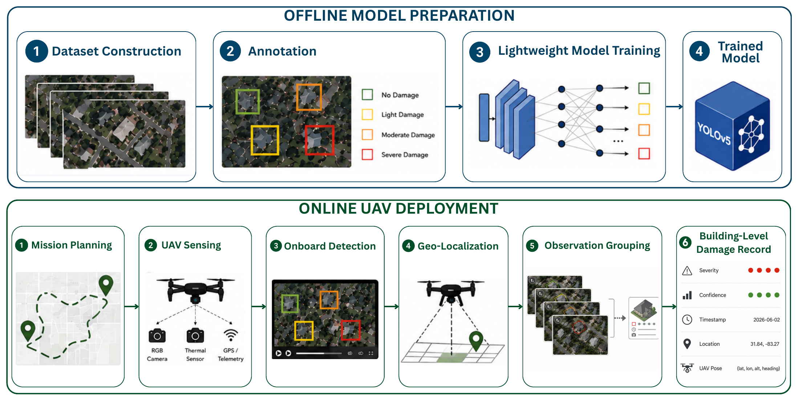

# DamageScout

DamageScout is a UAV-based building damage assessment pipeline built for NVIDIA Jetson
and Pixhawk. It runs YOLOv5 on RGB imagery, records video and flight telemetry, estimates
detection locations, and groups repeated observations into building-level damage records.
Optional thermal recording supports additional flight data collection.

## Framework



[View framework PDF](assets/methodology.pdf)

This repository implements onboard recording and post-flight processing. Model training is
available in the [damage detection framework](https://github.com/Kennesaw-IntelliTrust-Lab/Lightweight-and-Privacy-Enhanced-Damage-Detection-Framework).

## Features

- Pixhawk arm/disarm controlled recording with segmented video and checkpoints.
- Onboard YOLOv5 detection, class-organized crops, and geolocation metadata.
- Post-flight grouping by location and time, with consensus damage labels.
- CSV/JSON damage records, class-count plots, and optional video segment merging.

## Getting Started

On a Jetson with the camera, MAVLink, and YOLOv5 dependencies configured:

1. Edit [pixhawk_recorder/config.py](pixhawk_recorder/config.py): set camera, storage,
   YOLOv5 repository, and model weights paths.
2. Set `use_pixhawk = True` for arm/disarm control and check the MAVLink port and baud rate
   (Pixhawk control is disabled by default).
3. Start the recorder:

```bash
python3 run.py
```

In Pixhawk mode, each arm/disarm cycle creates a new flight folder under `save_root`.
Camera calibration and mount settings affect geolocation accuracy; locations use a
flat-ground estimate and are not survey-grade.

## Outputs

Each flight folder contains segmented RGB video, optional thermal video, detection CSVs,
class-organized crops, geolocation metadata, telemetry, and logs. When automatic aggregation
is enabled, `damage_records/` adds building-level CSV/JSON records and summary plots.

To regenerate damage records after copying a flight to your laptop:

```bash
python3 laptop_postprocess/standalone_damage_aggregator.py /path/to/flight_0001
```

See [laptop post-processing](laptop_postprocess/README.md) for video merging, crop statistics,
and aggregation options. A [sample systemd service](systemd/pixhawk-drone-recorder.service)
is also provided; update its user and paths before deployment.
